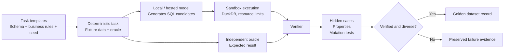
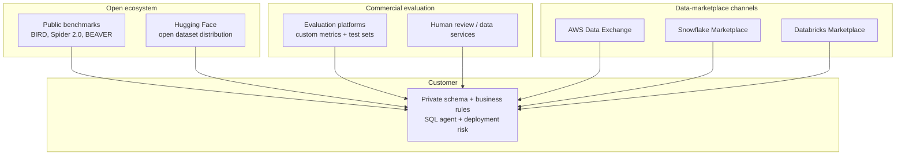
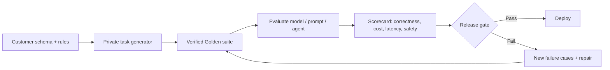

# Verified SQL Dataset Factory — Market Research Notebook

Research date: 2026-09-25  
Purpose: explain what we have built, why it matters, how the market works, and how it could become a business.

## 1. The short answer

There is a real market need for trustworthy SQL evaluation data. Companies are building AI assistants that turn natural language into SQL, but they cannot safely deploy them unless they can measure whether generated SQL is correct on their own schema, business rules, and database dialect.

The important distinction is this:

> The valuable product is not merely a collection of SQL strings. It is a **versioned proof system** showing that each accepted SQL example executed correctly, produced the right result, survived additional tests, and can be traced back to a task, schema, fixture, model, and verifier version.

A generic exported dataset is useful as a public demonstration, benchmark, or low-cost training pack. The stronger commercial product is a private evaluation and dataset-generation service for a customer's own data model.

## 2. What we have built

We are building a **Verified SQL Data Factory**. It creates synthetic SQL tasks, asks a model to solve them, then independently decides whether each solution is correct. The model is never trusted simply because it generated plausible SQL.



### What makes a record Golden

A Golden candidate is not “a SQL query that looks good.” It must pass all applicable gates:

1. The model response must parse into usable SQL.
2. The SQL must execute in the controlled database engine.
3. Its output must match an independently produced expected result.
4. It must survive hidden fixture variants, properties, and mutation tests where applicable.
5. It must pass the dataset-quality checks, including duplicate/diversity and audit rules.

This is stronger than string matching against one reference query. Two SQL queries can have different text yet be equivalent; conversely, a query can happen to return the right rows on one small fixture while being wrong in general. NVIDIA makes the same caution about execution-only evaluation on small datasets. [NVIDIA NeMo Data Designer](https://docs.nvidia.com/nemo/datadesigner/dev-notes/text-to-sql-for-nemotron-super)

### Progress so far

| Stage | What happened | What we learned |
|---|---|---|
| Pilot-001 | Diagnosed failed task families | Several task contracts were not explicit enough for reliable model solving. |
| Task-contract v2 | Added explicit output contracts for the affected templates | Requirements are now visible to the model and verifier without weakening verification. |
| Pilot-002 with Mistral | Generated, executed, verified, and quality-filtered a frozen diagnostic set | The end-to-end pipeline works, but model quality differs sharply by SQL family. |
| Devstral qualification | Ran the same frozen set with Devstral | No provider, sandbox, oracle, or comparator defect was found; model dialect adherence was the major weakness. |
| Production-001 | Fresh 500-task, 10-family run, three candidates per task | In progress as of this notebook: 269/500 bundles and 807/1,500 candidate attempts persisted. |

### Important finding: the pipeline caught a real model failure

Devstral frequently generated `DATE_FORMAT(...)` and `TO_CHAR(...)` while the prompt required DuckDB. Those functions are not valid DuckDB functions. The sandbox correctly rejected them; the verifier did not let them become Golden records.

That is evidence that the product is doing useful work. Without a verification layer, these queries could have been incorrectly sold or used as “training quality” examples.

## 3. What market problem this addresses

### The customer problem

An organization deploying a SQL agent has to answer four questions before production:

1. Does the model understand our schema and business definitions?
2. Does it generate correct SQL in our actual dialect?
3. Will a model/prompt/schema update cause a regression?
4. Can we prove reliability to security, data, and business stakeholders?

Public benchmarks are helpful, but they do not answer these questions for a customer's private warehouse. Spider 2.0 focuses on enterprise-style workflows, including databases with more than 1,000 columns and long contexts. Its authors report far lower success in those realistic settings than on older benchmarks. [Spider 2.0](https://spider2-sql.github.io/)

BIRD-SQL demonstrates the size of the existing benchmark category: 12,751 question–SQL pairs, 95 databases, 37 professional domains, and 33.4 GB of data. [BIRD-SQL](https://bird-bench.github.io/)

This means the need is real, but also that a small generic benchmark alone is not a new category.

### Who could buy

| Buyer | Their job | What they would pay for |
|---|---|---|
| AI/data platform team | Ship an internal analytics copilot safely | Private evaluation suite, regression gates, model comparison |
| BI or analytics product company | Improve text-to-SQL reliability for its customers | Dialect/domain packs and continuous model evaluation |
| Consultancy / systems integrator | Deliver SQL-agent projects to clients | A repeatable verification service and auditable handover package |
| Model builder | Train or compare a model on targeted SQL work | Licensed, documented, dialect-specific training/evaluation data |
| Regulated enterprise | Demonstrate controls over AI-generated analytics | Provenance, audit evidence, isolated execution, customer-owned data |

## 4. How the market works today



### A. Open benchmark and research ecosystem

There are already credible public SQL benchmarks:

- **BIRD-SQL:** broad databases, domains, and execution-based evaluation. [BIRD-SQL](https://bird-bench.github.io/)
- **Spider 2.0:** enterprise-oriented workflows, including cloud/database environments and large schemas. [Spider 2.0](https://spider2-sql.github.io/)
- **BEAVER:** an enterprise benchmark with fine-grained subtask analysis and execution accuracy. [BEAVER repository](https://github.com/beaverbench/beaver)

This is good news: buyers understand the concept of evaluation data. It is also a warning: a generic question–SQL export must be clearly differentiated in quality, dialect coverage, realism, license, or usability.

### B. Evaluation-platform ecosystem

Commercial evaluation vendors position evaluation data as the way to establish trust and catch regressions. For example, Scale describes automated and custom evaluation datasets, human checks, improvement loops, and monitoring as one enterprise workflow. [Scale AI enterprise evaluation](https://scale.com/evaluation/enterprise)

This supports the stronger commercial positioning: **the dataset is part of an ongoing reliability product**, rather than the entire product.

### C. Data-product marketplace ecosystem

There are real channels through which data products can be distributed and sold:

| Channel | What it supports | Relevance to us |
|---|---|---|
| Hugging Face | Public, gated, or versioned dataset repositories; dataset cards expose license, size, tags, and intended use | Best first home for a free sample or research edition. [Dataset cards](https://huggingface.co/docs/hub/en/datasets-cards) |
| AWS Data Exchange | Providers package data products, set terms and prices, and use subscription or pay-as-you-go models | Possible later commercial channel for downloadable/licensed packs. [AWS documentation](https://docs.aws.amazon.com/data-exchange/) [pricing](https://aws.amazon.com/data-exchange/pricing/) |
| Snowflake Marketplace | Curated data offerings; paid listings are supported | Useful if the offering is a governed Snowflake data share or app. [Snowflake Marketplace](https://docs.snowflake.com/en/collaboration/collaboration-marketplace-about) |
| Databricks Marketplace | Providers and software vendors can publish offerings directly to Databricks users | Useful for Delta/Unity Catalog-oriented products or a companion application. [Databricks Marketplace](https://docs.databricks.com/aws/en/marketplace) |

Important limitation: Snowflake Marketplace permits data shares, Native Apps, and Connected Apps; professional services are not eligible as listings. A managed bespoke evaluation service would therefore be sold directly, with a marketplace listing used only for its packaged data/app portion. [Snowflake listing policy](https://docs.snowflake.com/en/collaboration/policies-guidelines-enforcement)

## 5. What should we actually sell?

### Option 1 — Generic dataset export

**Offer:** Downloadable JSONL/Parquet containing NL question, schema, SQL, expected outputs, and metadata.

**Good for:** awareness, research users, lead generation, a low-price self-serve product.

**Problem:** it is easy to compare against free alternatives. A 500-task synthetic DuckDB-only dataset will not be enough by itself to justify a high price.

### Option 2 — Curated dialect or domain packs

**Offer:** A versioned pack such as “Postgres SaaS-metrics evaluation pack,” “Snowflake retail analytics pack,” or “BigQuery finance controls pack.”

**Good for:** model builders, tool vendors, and teams who do not need customer-specific schemas yet.

**What it needs:** thousands of high-quality examples, realistic large schemas, clear licensing, independent quality statistics, train/validation/test splits with no template leakage, and documented limitations.

### Option 3 — Customer-specific evaluation factory (recommended first business)

**Offer:** The customer provides an isolated schema description and business rules. We generate a private evaluation suite, evaluate their chosen models/prompts, and provide a regression report and release gate.

**Why it wins:** it solves the exact problem a buyer has: “Can I deploy this SQL agent safely against *my* data?” It is much harder to replace with an open benchmark.

### Option 4 — Continuous evaluation platform

**Offer:** An API/CLI/hosted service that reruns the customer's Golden suite whenever the model, prompt, semantic layer, schema, or SQL engine changes.

**Why it is durable:** recurring value, observable regressions, and growing proprietary failure coverage.



## 6. Recommended commercial position

**Positioning statement:**

> We help teams prove that their text-to-SQL agent works on their own schema before it reaches users. Every evaluation case is executable, independently verified, versioned, and traceable.

Do not lead with “we sell SQL datasets.” Lead with:

- “prevent bad analytics answers from reaching production”
- “compare SQL-agent models on your real business rules”
- “detect regressions before a model or prompt change ships”
- “create a verified private training/evaluation set without exposing production records”

## 7. Product requirements before selling

### Minimum data product package

A buyer needs more than JSONL. Each release should contain:

1. Dataset card: purpose, scope, intended use, limitations, versions, contact, and license.
2. Schema/DDL and fixture-generation instructions.
3. Tasks, candidate SQL, expected results, and verification evidence.
4. Reproducible execution harness and pinned database-engine version.
5. Train/validation/test split policy that prevents template leakage.
6. Quality report: pass rate, Golden yield, duplicate rate, coverage, and known gaps.
7. License/provenance statement for every template, fixture, and model-generated output.
8. Security/privacy statement: synthetic data only, or precise rules for customer-isolated data.

Dataset cards are a normal market expectation: Hugging Face documents the use of dataset cards to show licensing, size, language, intended use, and discovery metadata. [Hugging Face dataset cards](https://huggingface.co/docs/hub/en/datasets-cards)

### Capability gaps to close

| Gap | Why it matters | Next move |
|---|---|---|
| DuckDB-only execution | Most enterprise buyers use Snowflake, BigQuery, Postgres, Databricks, or SQL Server | Add dialect adapters and qualify each separately. |
| Small synthetic schemas | Enterprise schemas have many tables, long context, semantics, and messy definitions | Add realistic domain packs and schema-scale tiers. |
| Model-specific weak families | A production dataset must cover all stated families | Use failures to improve prompts/models, then requalify; never weaken the verifier. |
| No buyer evidence yet | Market need is not the same as willingness to pay | Run structured customer discovery and secure design partners. |
| License/commercial review pending | Model output and source templates must be saleable | Complete legal/provenance review before any paid release. |

## 8. What not to do

- Do not call model output Golden merely because it executes once.
- Do not weaken or bypass the verifier to increase the yield metric.
- Do not sell the active production output until the quality, provenance, and licensing reports are complete.
- Do not claim general enterprise reliability from a small synthetic DuckDB corpus.
- Do not use a public benchmark's hidden/test data for training if its terms or benchmark guidance prohibit it. Spider 2.0 specifically warns against using its released Gold SQL for supervised fine-tuning because it can damage fair evaluation. [Spider 2.0](https://spider2-sql.github.io/)

## 9. Go-to-market plan

### Phase 1 — Prove the technical product

1. Finish Production-001 with its verifier and quality report.
2. Publish an honest technical report: coverage, Golden yield, model failure taxonomy, and limitations.
3. Release a small free research/sample edition with a dataset card and reproducible harness.
4. Add one second dialect before claiming broad applicability.

### Phase 2 — Validate willingness to pay

Interview 10–15 people in data-platform, analytics-engineering, AI-platform, and BI-product roles. Do not ask “Would you buy a dataset?” Ask:

- What breaks when your SQL assistant is wrong?
- How do you test model/prompt/schema changes today?
- Do you have a known set of business questions and expected answers?
- Which database engines and domains matter?
- What evidence would let you approve a deployment?
- Would you pay for a private benchmark and release gate? What budget owner would fund it?

Success criterion: secure 2–3 design partners willing to provide an isolated schema or synthetic replica and agree to a paid or tightly scoped pilot.

### Phase 3 — Sell a pilot

Pilot deliverable:

```text
Customer schema + definitions
        ↓
Private verified task suite
        ↓
Model / prompt comparison
        ↓
Failure taxonomy + regression baseline
        ↓
Release recommendation and recurring test plan
```

Charge for outcome and setup first, not per raw SQL row. Convert successful pilots into a recurring evaluation subscription or annual platform license.

## 10. Decision summary

| Question | Answer |
|---|---|
| Is there a real need? | Yes. Reliable text-to-SQL evaluation is an active enterprise and research problem. |
| Is a verified Golden dataset valuable? | Yes, because correctness, reproducibility, provenance, and hidden tests are valuable. |
| Will a generic 500-row DuckDB export sell easily? | Unlikely at meaningful price; free benchmarks create strong competition. |
| What is the strongest product? | Private, versioned, dialect-specific SQL-agent evaluation and regression testing. |
| What is the right first distribution? | Free sample/research edition, direct design-partner pilots, then marketplace/app distribution for mature packaged assets. |
| What must remain non-negotiable? | Independent verification, auditable provenance, explicit limitations, and no fabricated quality claims. |

## Sources

1. [Spider 2.0 — Enterprise text-to-SQL evaluation](https://spider2-sql.github.io/)
2. [BIRD-SQL benchmark](https://bird-bench.github.io/)
3. [BEAVER enterprise benchmark](https://github.com/beaverbench/beaver)
4. [NVIDIA: engineering an enterprise text-to-SQL dataset](https://docs.nvidia.com/nemo/datadesigner/dev-notes/text-to-sql-for-nemotron-super)
5. [Scale AI: enterprise AI evaluation](https://scale.com/evaluation/enterprise)
6. [Hugging Face dataset cards](https://huggingface.co/docs/hub/en/datasets-cards)
7. [AWS Data Exchange documentation](https://docs.aws.amazon.com/data-exchange/)
8. [AWS Data Exchange pricing](https://aws.amazon.com/data-exchange/pricing/)
9. [Snowflake Marketplace overview](https://docs.snowflake.com/en/collaboration/collaboration-marketplace-about)
10. [Snowflake Marketplace listing policies](https://docs.snowflake.com/en/collaboration/policies-guidelines-enforcement)
11. [Databricks Marketplace overview](https://docs.databricks.com/aws/en/marketplace)
