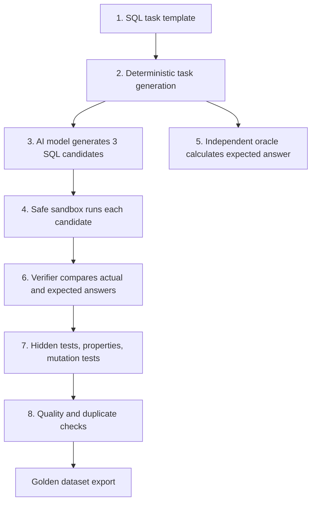
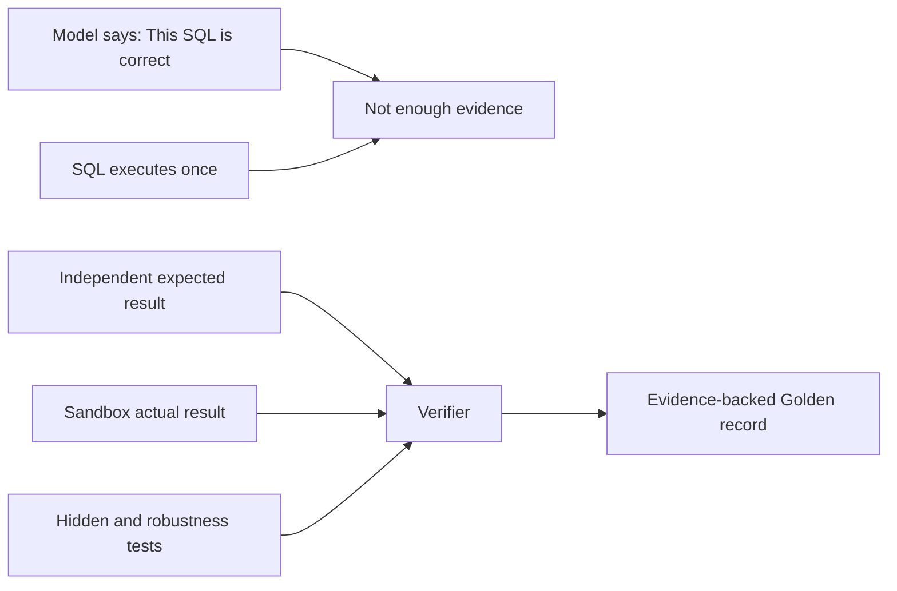

# Verified SQL Data Factory — Start From Zero

This guide explains the project from the beginning. Read it before the market-research notebook.

## 1. The one-sentence project

We are building a system that creates SQL questions, asks an AI model to write SQL answers, and keeps only the answers that we can independently prove are correct.

The proven answers are called **Golden SQL records**.

## 2. Database basics

### What is a database?

A database is an organized place to store information. Think of a school keeping lists of students, teachers, classes, and marks. Instead of paper registers, a database stores that information in tables.

### What is a table?

A table is like a spreadsheet.

| customer_id | name | country |
|---:|---|---|
| 1 | Asha | India |
| 2 | Rahul | India |

Each horizontal line is a **row** (one record). Each vertical field is a **column** (one type of information).

### What is a schema?

A **schema** is the blueprint of the database. It says:

- which tables exist;
- which columns each table has;
- what type of value each column may hold, such as text, number, date, or timestamp;
- how tables are related.

For example, an `orders` table may have `order_id`, `customer_id`, `order_date`, `amount`, and `status`. The `customer_id` links an order to a row in the `customers` table.

### What is SQL?

**SQL** means Structured Query Language. It is a language used to ask a database questions.

Example question: “How many completed orders did each customer make in 2025?”

Example SQL:

```sql
SELECT customer_id, COUNT(*) AS completed_orders
FROM orders
WHERE status = 'completed'
  AND EXTRACT(YEAR FROM order_date) = 2025
GROUP BY customer_id
ORDER BY customer_id;
```

SQL has different dialects, similar to accents in spoken language. A query that works in MySQL may not work in DuckDB, Snowflake, BigQuery, or Postgres. This matters a lot in this project.

### Common SQL words

| Term | Simple meaning |
|---|---|
| `SELECT` | Choose the columns you want to see. |
| `FROM` | Say which table to read. |
| `WHERE` | Filter rows. |
| `GROUP BY` | Put similar rows together before counting or summing. |
| `JOIN` | Combine related tables. |
| `ORDER BY` | Sort the result. |
| CTE | A named temporary query used inside a larger query. |
| Window function | A calculation across related rows without collapsing them into one row. |
| NULL | A missing/unknown value, not the same as zero or empty text. |

## 3. The problem with AI-written SQL

An AI can write SQL that looks convincing but is wrong. For example, it may:

- use a column that does not exist;
- use a function from the wrong SQL dialect;
- join two tables incorrectly and duplicate rows;
- return the right result only for one small dataset by accident;
- misunderstand a business rule such as “completed orders only”; or
- return columns in the wrong order or with the wrong meaning.

This is dangerous because a wrong analytics answer may influence business decisions while still looking professional.

## 4. What is a Golden SQL record?

A **Golden SQL record** is a training or evaluation example that has evidence behind it.

It contains more than a question and a query:

```text
Natural-language question
        +
Schema and fixture data
        +
AI-generated SQL
        +
Expected answer from an independent oracle
        +
Execution result and verification evidence
        =
Golden SQL record, only if every required check passes
```

The word “Golden” does not mean “generated by a famous model.” It means “accepted by the independent verification process.”

## 5. Our factory, step by step



### Step 1: Task template

A task template is a reusable recipe. It defines a type of SQL task, for example:

- grouped aggregation;
- common table expression (CTE);
- duplicate removal;
- conversion funnel;
- monthly/temporal analysis;
- joins;
- subqueries;
- window functions;
- retention.

The template says what tables, columns, business rules, output columns, edge cases, and oracle strategy are required.

### Step 2: Deterministic task generation

The factory uses a **seed**, which is a fixed starting number used to generate synthetic data in a repeatable way. If we use the same template and seed again, we get the same fixture data.

This is important because it makes results reproducible. Nobody has to guess which input data the SQL was tested against.

### Step 3: Model generation

The model receives only the public information it needs:

- SQL dialect, currently DuckDB;
- table schema/DDL;
- natural-language instruction;
- explicit public output contract.

It does **not** receive the hidden expected result or the internal oracle logic.

For each task, the model produces three candidate queries. Multiple candidates give the system several attempts without pretending that one model answer is guaranteed correct.

### Step 4: Sandbox execution

The candidate SQL runs in a controlled DuckDB environment with limits on time, memory, processes, and result size.

The sandbox protects the host machine and gives a factual answer: did the SQL execute, and what rows did it return?

### Step 5: Independent oracle

An **oracle** is the source of truth used to calculate the expected answer. It is independently implemented from the model-generated query.

For example, if the task asks for monthly revenue, the oracle calculates monthly revenue with its own known logic. The model is not asked to grade itself.

### Step 6: Verification

The verifier compares the candidate query result with the oracle result. It checks items such as:

- output column names and order;
- row values;
- row ordering when ordering is required;
- floating-point tolerances;
- hidden test fixtures;
- applicable properties and metamorphic relations.

### Step 7: Stronger tests

The factory uses more than one example dataset where possible.

- **Hidden tests:** fresh fixture variations not shown to the model.
- **Property tests:** rules that should always hold, for example that changing input row order should not change an aggregation result.
- **Metamorphic tests:** transform the input in a controlled way and check the expected relationship in output.
- **Mutation tests:** deliberately make an oracle/query-like change that should produce a wrong answer, then confirm that the verifier catches it.

### Step 8: Dataset quality

Even a correct query may not become Golden. The quality stage checks for duplicate or near-duplicate outputs, missing family coverage, and records requiring audit. This prevents a dataset from being filled with the same easy pattern again and again.

## 6. Why the pipeline is designed this way



The system separates roles:

| Role | What it does | What it must not do |
|---|---|---|
| Model | Proposes SQL | Decide it is correct |
| Sandbox | Executes SQL | Decide business correctness |
| Oracle | Calculates expected result | Reuse the model’s SQL as truth |
| Verifier | Compares evidence | Invent an answer |
| Quality stage | Selects diverse, useful records | Hide failures |

This separation is why a low Golden yield can be good news: it can mean the system is honestly rejecting bad model output.

## 7. Work completed so far

### Pilot-001

The first pilot found that several SQL task families had unclear public task contracts. In plain words, models did not have sufficiently explicit instructions about the expected output.

### Contract v2 fix

The affected templates were updated so their public requirements are clearer, including explicit expected output columns and task rules. The verifier itself was not weakened.

### Pilot-002

Pilot-002 used a frozen diagnostic task set to test whether the new contracts worked. It ran task generation, model generation, sandbox execution, verification, and quality filtering.

The important result was that the pipeline is able to distinguish correct and incorrect model SQL rather than merely collecting text.

### Devstral qualification

The selected local model, Devstral Small 24B, was smoke-tested and then qualified against the frozen Pilot-002 tasks.

Actual qualification result:

- 480 candidates were checked.
- 171 passed independent verification.
- 42 became Golden after final quality gates.
- No provider, sandbox, oracle, or comparator integrity defect was found.

The key weakness was not a broken checker. Devstral often produced date functions from MySQL/Postgres, such as `DATE_FORMAT` and `TO_CHAR`, even though the prompt required DuckDB. The sandbox correctly rejected those SQL queries.

### Production-001

Production-001 is the first broader dataset run. It has:

- 500 fresh synthetic tasks;
- 10 balanced SQL families;
- 50 tasks per family;
- 3 candidates per task;
- 1,500 candidate attempts in total.

It is resumable: completed artifacts are written to disk as the run continues. Its final quality result must not be claimed until generation, execution, verification, and quality filtering finish.

## 8. What is working and what is not yet solved

| Area | Status | Explanation |
|---|---|---|
| Deterministic task creation | Working | The same seed regenerates the same task and fixtures. |
| Model generation | Working | Local models generate SQL candidates. |
| Sandbox | Working | It runs SQL safely and rejects invalid DuckDB syntax/functions. |
| Independent verification | Working | It checks results against an oracle plus stronger tests. |
| Quality filtering | Working | It avoids calling duplicates/weak records Golden. |
| CTE and temporal model performance | Weak | Devstral repeatedly uses non-DuckDB date syntax or logically incorrect time queries. |
| Dialect coverage | Limited | Current execution target is DuckDB; enterprise buyers often need Snowflake, Postgres, BigQuery, etc. |
| Schema realism/scale | Limited | Current synthetic schemas are useful for controlled tests but are smaller than many enterprise environments. |
| Commercial readiness | Not complete | Licensing/provenance, multi-dialect support, broader quality evidence, and customer validation are needed. |

## 9. Why build this if existing SQL datasets already exist?

Public datasets and benchmarks are useful, but a company deploying a SQL agent needs answers for its own database:

- its own tables;
- its own business definitions;
- its own SQL engine;
- its own access/security rules;
- its own model and prompt updates.

This factory can create a private, repeatable evaluation suite and rerun it every time something changes. That is more valuable than a one-time list of generic SQL examples.

## 10. Future direction

The best commercial direction is likely:

```text
Customer schema + business rules
        ↓
Private verified SQL task suite
        ↓
Compare models, prompts, and agent designs
        ↓
Regression report and release gate
        ↓
Safer customer deployment
```

Before selling broadly, the system should add more SQL dialects, more realistic domain/schema packs, a complete provenance and license review, and customer design-partner testing.

## 11. Important honesty rules

1. A model-generated query is not Golden until it passes independent verification.
2. A completed execution is not proof of semantic correctness.
3. Low Golden yield is not automatically a system defect; it may reveal a weak model or ambiguous task.
4. The verifier must never be weakened merely to make success numbers look better.
5. Current production output is not a final commercial dataset until the full run and quality report complete.

## 12. Questions to ask NotebookLM

After uploading this guide and the market-research notebook, ask:

> Teach me this project in three layers: first like I am 15, then like a new software engineer, then like a CTO. Define every new term before using it. Use a concrete `customers` and `orders` example throughout. Separate proven project results, current work in progress, and future business plans.

> Make a glossary of every database, SQL, AI, verification, and business term in these sources. Give each term a one-line simple explanation and one technical explanation.
